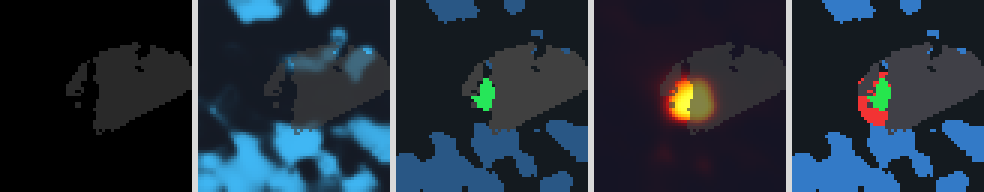
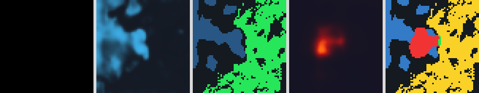

# burn-scar-prediction-model

Predicción multi-horizonte del **crecimiento** de cicatrices de incendio forestal en el
Mediterráneo, a 300 m por píxel, construida íntegramente con datos satelitales y climáticos
abiertos.

## Qué hace

El modelo mira la situación actual de un incendio y devuelve **un mapa de probabilidad de
nueva quema** para un horizonte que se pide explícitamente (por ejemplo, "dónde ardará en
3 días").

> **No predice la cicatriz, predice el frente.** La cicatriz —"¿dónde está quemado
> ahora?"— no crece cuando el fuego se apaga; lo que crece es el fuego. Por eso la tarea
> es **propagación**, no delineación. Ver [`docs/investigacion.md`](docs/investigacion.md) §2.

| | |
|---|---|
| **Entradas** | Sentinel-3 OLCI (5 bandas, ~2 días) · cicatriz actual generada por **TMB-S3 congelado** · Copernicus DEM · ESA WorldCover · el horizonte *h* en días |
| **Salida** | Probabilidad de quema por píxel, píxel a píxel, para el horizonte pedido |
| **Se mide contra** | Las delineaciones del Copernicus Emergency Management Service (CEMS): el único dato público que dibuja el crecimiento de un incendio mirando imágenes **distintas** de las del modelo |
| **Alcance** | Región mediterránea, 300 m, producto cada ~2-3 días (lo que tarda Sentinel-3 en volver a pasar) |
| **Arquitectura** | Encoder ConvLSTM + SegFormer con una cabeza de propagación |

Sentinel-1, Sentinel-2 y la meteorología **no forman parte del modelo entrenado**: están
previstos para una segunda versión.

## Estado

**Modelos entrenados (`M-A`, `M-B`, Tversky y desde cero) y dataset canónico regenerado.**
El dataset vigente contiene **296 muestras únicas en 40 series**, con horizontes continuos,
inventario de calidad y capas estáticas validadas.

Conjunto de test (fold -1, 25 muestras, 7 series), todos los modelos y baselines evaluados
bajo el mismo protocolo y umbral común (`0,10`), más el umbral operativo CV (`0,20`):

| Modelo | Umbral | F1 (ensamblaje) | F1 (referencia, propagación real) | Precisión (ensamblaje) |
|---|---:|---:|---:|---:|
| BASE-0 persistencia | 0,10 | 0,00% | 0,00% | 0,00% |
| BASE-1 dilatación radial | 0,10 | 15,94% | 7,30% | 19,11% |
| Trivial "todo quemado" | 0,10 | 16,29% | 8,42% | 9,41% |
| **M-A** (`mcd_pretrained`, cero-disparo sin CEMS) | 0,10 | **19,71%** | **10,61%** | 14,05% |
| **M-B** (`prop_m_b_finetuned`, BCE+Dice) | 0,10 | **30,98%** | **11,80%** | 29,89% |
| **M-B + Tversky** (`prop_m_b_tversky`, α=0,7, β=0,3, w_max=5) | 0,10 | **32,90%** | **10,08%** | **39,53%** |
| **Modelo de producción** (`prop_v4_integrity`, umbral común) | 0,10 | **36,46%** | **14,68%** | 28,40% |
| **Modelo de producción** (`prop_v4_integrity`, umbral operativo CV) | 0,20 | **39,34%** | **10,59%** | 33,12% |

El número publicable de propagación es el de la **referencia** (**14,68%** a umbral común
0,10): la etiqueta de ensamblaje incluye quemado que TMB-S3 no detectó. `M-A` demuestra
transferencia pura en cero-disparo superando a `BASE-1` y al trivial sin haber visto CEMS; `M-B + Tversky`
estabiliza el umbral entre folds (`0,10–0,20`) y eleva la precisión al **39,53%**. El arranque
en frío **no está representado** y no se publica un desempeño para él; las bandas de horizonte
se reportan solo como diagnóstico y no filtran nada. La tabla completa, con IoU, precisión,
recall, soporte por banda y recuentos evaluables, está en
[`docs/operacion.md`](docs/operacion.md) §9.

Dos cosas que conviene saber antes de citar cifras:

- El run anterior `prop_v4` queda como **histórico y no publicable**: su índice tenía
  entradas duplicadas y una serie de test con WorldCover vacío.
- `M-A`, `M-B` y `M-B + Tversky` están entrenados y medidos **sobre el mismo test, con el
  mismo umbral y el mismo subconjunto evaluable** que el modelo de producción (tabla
  arriba). `M-A` ya supera a BASE-1 y al trivial sin haber visto CEMS; el ajuste `M-B` mejora a
  `M-A`, pero todavía no supera al entrenamiento desde cero.
- Las cifras son **comprobables**: los JSON de resultados (baselines sobre el dataset
  canónico, auditorías de integridad y una reproducción local del run) están versionados en
  [`artefactos/resultados/`](artefactos/resultados/README.md).

### Ver el modelo en acción

Cada panel es una tira de cinco bloques: la imagen de entrada, la cicatriz conocida, **la
verdad** (verde = quemado nuevo), **lo que predice el modelo** (mapa de calor) y el
overlay de aciertos (**verde = acierto, rojo = falsa alarma, amarillo = omisión**).

| Mejor muestra (M-B + Tversky) | Peor muestra (M-B + Tversky) |
|---|---|
|  |  |

La izquierda acierta el frente; la derecha es un fallo honesto: predice donde no se quemó
y se deja el quemado real sin ver. Están las 40 en [`outputs/`](outputs/), con su
explicación en [`docs/experiment-tracking.md`](docs/experiment-tracking.md) §6.

## Puesta en marcha

```bash
# 1. Entorno (elige el extra de tu GPU: rocm | cuda | cpu)
uv sync --extra rocm --group dev
cp .env.example .env        # credenciales de Earth Engine y almacenamiento compartido

# 1b. Checkpoint de TMB-S3 (el generador de cicatriz). El repo de Hugging Face es
#     privado: hay que autenticarse (hf auth login) y aceptar la licencia.
uv run python -c "from huggingface_hub import snapshot_download; \
  snapshot_download('links-ads/tmb-s3-models', local_dir='models/tmb_s3', \
                    allow_patterns=['convlstm_segformer_prepost_subset/*'])"
#     -> models/tmb_s3/convlstm_segformer_prepost_subset/model.safetensors

# 2. Dataset. No se versiona en Git: cada máquina genera el suyo (~20 s en GPU).
#    El pipeline completo, desde cero (auditoría -> manifiesto -> vectores CEMS ->
#    rasterización -> OLCI/DEM/WorldCover -> ensamblaje), está con sus comandos
#    en docs/dataset.md §11. El paso final, si el dataset ya está descargado:
uv run --extra rocm python scripts/build_pytorch_dataset.py

# 3. Baselines de referencia (BASE-0, BASE-1 y el trivial "todo quemado")
uv run --extra rocm python scripts/evaluate_baselines.py

# 4. Entrenamiento: validación cruzada de 5 folds (~2 min con el dataset vigente)
uv run --extra rocm python scripts/train_propagation.py \
      --epochs 15 --seed 42 --tag prop_v4_integrity

# 5. Reevaluar un run sin reentrenar, o auditar el dataset
uv run --extra rocm python scripts/train_propagation.py --eval-only checkpoints/<run>
uv run --extra rocm python scripts/audit_dataset_integrity.py \
      --index data/processed/dataset_index.json --output runs/dataset_integrity_production.json

# 6. Verificar que los artefactos canónicos no han cambiado
uv run --extra rocm python scripts/verify_canonical_artifacts.py

# Tests
uv run pytest
```

**Antes de la primera descarga** hay que tener cuenta de Google Earth Engine y un proyecto
registrado: el arranque, los dos roles que hacen falta y los mensajes de error típicos
están en [`docs/operacion.md`](docs/operacion.md) §6.1. El paso 2 (generar el dataset)
**no es opcional** después de tocar el generador de cicatriz o la ventana temporal: la
cicatriz y el target quedan horneados en los `.npz`.

## Las seis decisiones que definen el proyecto

| | Decisión | Por qué |
|---|---|---|
| 1 | **La cicatriz la pone TMB-S3, congelado** | CEMS no existe en operación; con un modelo, la cicatriz se produce igual al entrenar y al predecir |
| 2 | **Se audita qué sabe TMB-S3** | Se sabe de memoria 50 de nuestras 96 series: esas series quedan fuera del dataset |
| 3 | **El objetivo se mide desde la última imagen** | Medir desde la ronda anterior contaría quemado que ya se ve en la imagen |
| 4 | **Validación cruzada en 5 bloques** | Con tan pocas series, un reparto fijo evaluaría una fracción y desperdiciaría el resto |
| 5 | **La resolución es 300 m** | Es la banda útil: a más resolución no hay imágenes tan frecuentes |
| 6 | **Se evalúa siempre contra CEMS** | Es el único etiquetado hecho por analistas mirando otras imágenes |

El detalle completo, con las alternativas descartadas y el porqué, está en
[`docs/decisiones.md`](docs/decisiones.md). Estas seis son el resumen de **B1-B13**
(`decisiones.md` §1.1) y **D1-D22** (`dataset.md` §7).

## Documentación

Empieza por [`docs/README.md`](docs/README.md), que es el índice y el mapa de qué dato vive
en qué fichero.

| Documento | Contenido |
|---|---|
| [`docs/dataset.md`](docs/dataset.md) | Qué es una muestra, qué se predice, el pipeline de construcción, las reglas D1-D22 y el protocolo de evaluación |
| [`docs/operacion.md`](docs/operacion.md) | Qué necesita el modelo en inferencia, cómo se regenera el dataset, los resultados canónicos y el preentrenamiento MCD64A1 |
| [`docs/decisiones.md`](docs/decisiones.md) | Decisiones cerradas (B), pendientes (P), alternativas descartadas, riesgos (R) y preguntas abiertas |
| [`docs/investigacion.md`](docs/investigacion.md) | Estado del arte, por qué 300 m, cómo verificar los números |
| [`docs/datos.md`](docs/datos.md) | Catálogo de fuentes: dónde está cada dato, IDs exactos, endpoints, licencias |
| [`docs/experiment-tracking.md`](docs/experiment-tracking.md) | Guía de TensorBoard compartido, checkpoints y sincronización NFS |
| [`docs/nixos.md`](docs/nixos.md) | Cómo trabajar el proyecto en NixOS con devenv (opcional) |

> ¿No sabes qué es una AOI, una delineación o el NBR? → [Glosario](docs/dataset.md#1-glosario).

## Próximos pasos (v2 / trabajo futuro)

1. **Estratificar la evaluación** por cambio de sensor y publicar el estrato de control de
   TMB-S3: los datos ya están en el índice, falta el reporte (P8).
2. Ampliar el conjunto y recuperar `EMSR785_AOI01` con una fuente estática que no devuelva
   WorldCover vacío.
3. Obtener observaciones genuinas de arranque en frío o mantenerlo explícitamente fuera del
   alcance de desempeño.
4. Evaluar la calibración de las salidas y la estabilidad del umbral por fold y horizonte.
5. Ampliar el soporte de la cola de horizontes antes de dar significado a más de tres días.

> **El viento queda fuera del alcance del proyecto.** No se implementa BASE-2 (advección por
> viento) ni el canal meteorológico (ERA5/GFS). El criterio de aceptación se sustituye por
> la comparación contra **BASE-1** y el **trivial "todo quemado"** medidos al mismo umbral
> operativo y sobre el mismo subconjunto evaluable. Ver
> [`docs/decisiones.md`](docs/decisiones.md) §1.2 (P2).

La auditoría reproducible del dataset, el barrido de umbrales y la procedencia de los runs están en
`scripts/audit_dataset_integrity.py`, `scripts/sweep_thresholds.py` y `operational_threshold.json`, respectivamente.

## Estructura

```
.
├── README.md
├── docs/          # la documentación (ver docs/README.md)
├── src/burn_scar/ # modelo, dataset, métricas, baselines y utilidades compartidas
├── scripts/       # ingesta, ensamblado, entrenamiento, evaluación y auditoría
├── tests/
├── openspec/      # flujo de trabajo OpenSpec (specs de dataset, evaluación, entorno y tracking)
├── artefactos/    # sumas de verificación y resultados publicables (ver artefactos/resultados/)
├── outputs/       # paneles PNG de las predicciones (ver docs/experiment-tracking.md §6)
├── pyproject.toml
└── .env.example
```

## Cómo citar los datos

Cada fuente tiene su norma de licencia y atribución. Están recogidas en
[`docs/datos.md`](docs/datos.md) §7 — conviene revisarlas antes de distribuir cualquier
dataset derivado.
